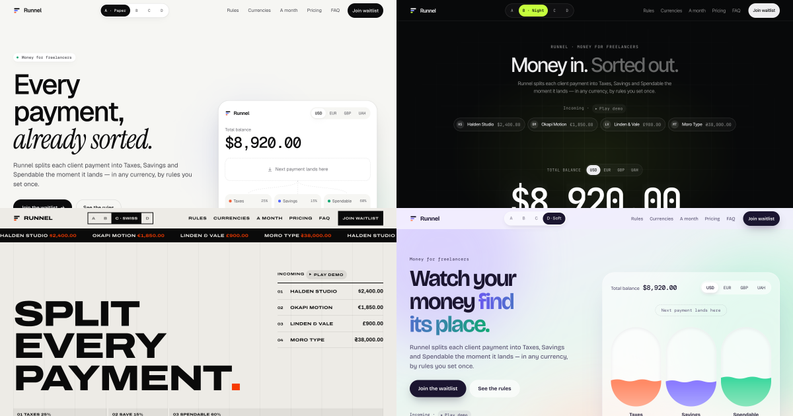
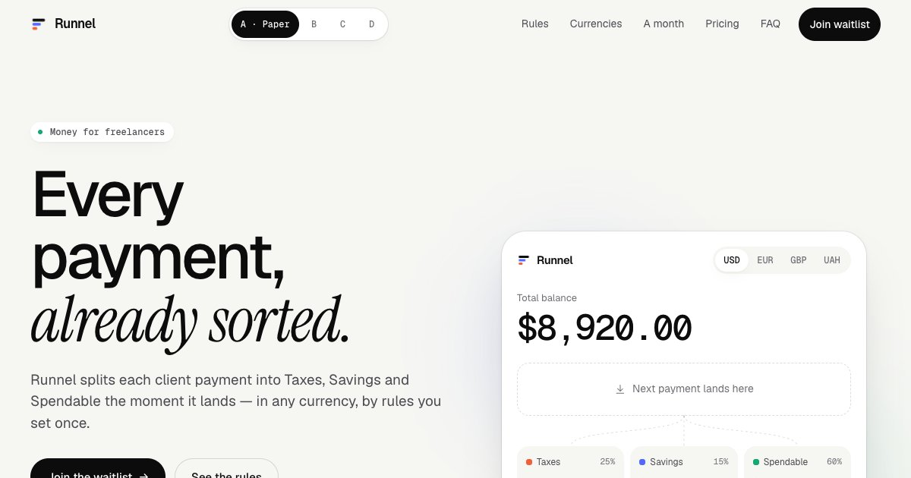
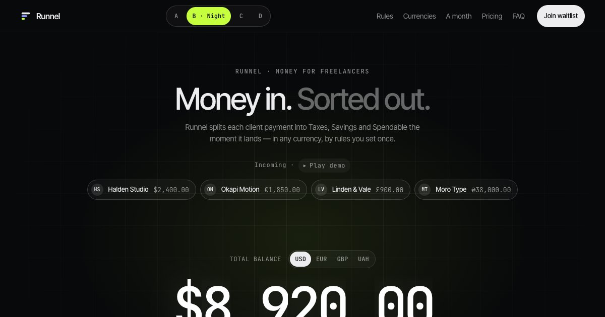
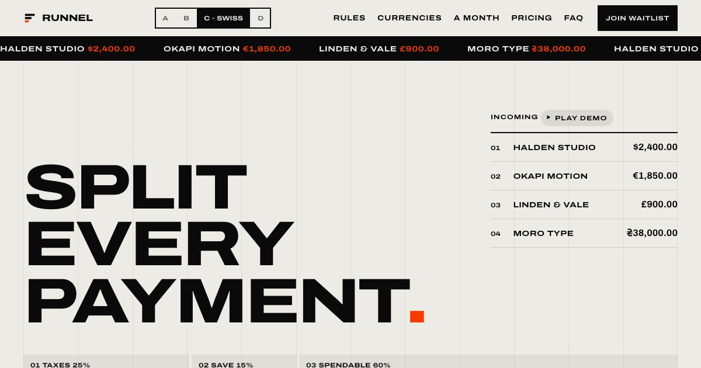
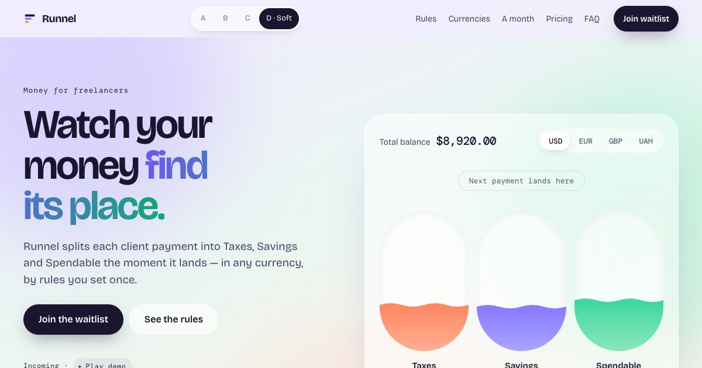
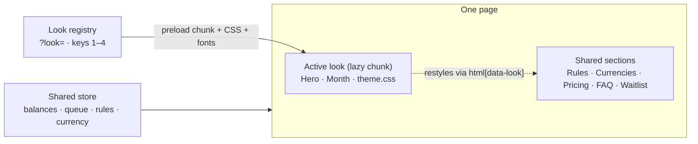

<div align="center">



# Runnel

**One product. Four designs. The same live state.**

Every client payment, in any currency, splits itself into **Taxes**, **Savings** and **Spendable** the moment it lands.<br>
The whole site exists in four complete design directions — switch between them without losing a thing.

### [▶ Open the live demo](https://kryvenkosergiy.github.io/Runnel/)

[](https://github.com/KryvenkoSergiy/Runnel/actions/workflows/deploy.yml)


</div>

---

## ✨ Try it in 30 seconds

| Do this | What happens |
|---|---|
| **Watch the first screen** — it plays by itself, on a loop | Payments arrive one by one, convert to your home currency and pour into three envelopes; when all four are sorted they drop back in |
| Press <kbd>1</kbd> <kbd>2</kbd> <kbd>3</kbd> <kbd>4</kbd> or use the switcher at the top | The page turns into another design, revealed in a circle from the button you pressed |
| Change the **home currency** or move the **rules** sliders | Every number on the page follows, in every design |
| Scroll through **A month with Runnel** | Thirty days of payments play out as you scroll |
| Press <kbd>?</kbd> | **How it's built** — a note on every section about the technique and why it was chosen |

Balances, the payment queue, rules and currency are shared by all four looks: a payment that lands in Paper is already in the balance when you switch to Night.

## 🎨 Four looks

<table>
  <tr>
    <td width="50%" valign="top">
      <a href="https://kryvenkosergiy.github.io/Runnel/?look=paper"></a>
      <h3>A · Paper — <i>expensive quiet</i></h3>
      Warm light paper, near-monochrome, colour only as data. Geist and Instrument Serif.<br>
      <b>Signature:</b> the payment chip morphs into the app, thin flows run to the envelopes and each one “breathes”.
    </td>
    <td width="50%" valign="top">
      <a href="https://kryvenkosergiy.github.io/Runnel/?look=night"></a>
      <h3>B · Night — <i>financial terminal</i></h3>
      Dark grid with a spotlight, one huge mono number, lime as the accent. Inter Tight and JetBrains Mono.<br>
      <b>Signature:</b> the payment drops in, a beam hits the balance, it flashes and rolls, then neon flows reach the columns.
    </td>
  </tr>
  <tr>
    <td width="50%" valign="top">
      <a href="https://kryvenkosergiy.github.io/Runnel/?look=swiss"></a>
      <h3>C · Swiss — <i>a poster that moves</i></h3>
      Visible 12-column grid, no shadows, no radii, red only as a signal. Archivo at 125% width.<br>
      <b>Signature:</b> the amount slides in, then the split bar fills segment by segment with curtains and wipes clean before the next one.
    </td>
    <td width="50%" valign="top">
      <a href="https://kryvenkosergiy.github.io/Runnel/?look=soft"></a>
      <h3>D · Soft — <i>money as liquid</i></h3>
      Pastel gradient, floating blobs, glass. Bricolage Grotesque and DM Mono.<br>
      <b>Signature:</b> a bubble pops in, drops fall on a gravity curve into glass jars, the liquid rises with a bounce and splashes.
    </td>
  </tr>
</table>

Every look also has its own **Month** scene and restyles the shared sections: rules, currencies, pricing, FAQ and waitlist.

## 🧭 How it works



- **One store, four skins.** A single `useReducer` store sits above the look loader, so switching never resets anything.
- **Looks are lazy chunks.** Each look brings its own fonts, `Hero`, `Month` and CSS scoped under `html[data-look="<id>"]`. Only the active one is downloaded; hovering a switcher button preloads the next.
- **A switch keeps your place.** The next look loads first, then a View Transition reveals it, and the page stays in the same section at the same depth.
- **Money is integer cents.** Taxes and savings round down and the remainder goes to spendable, so the parts always add up to the payment.

## 🧩 The platform, not libraries

No animation libraries and no CSS framework. Everything moves with what the browser already has:

| Native API | Used for | Without it |
|---|---|---|
| View Transitions | the circle look switch | the look changes instantly |
| Scroll-driven animations | section reveals | sections are simply visible |
| Web Animations API | the payment gliding into the app in Paper (FLIP), drops in Soft, the form shake | — |
| `interpolate-size`, `::details-content` | the FAQ opening smoothly | the FAQ opens without animation |
| CSS `linear()` easing | springs | — |

With **reduced motion** every effect has a calm version: the hero stays still, looks switch instantly, waves and blobs stand still, and each Month becomes four still frames instead of a pinned scroll scene.

## 📏 Performance and accessibility

Measured on the production build with Lighthouse:

| | Budget | Result |
|---|---|---|
| Start JS (gzip) | ≤ 85 kB | **77 kB** — React itself is about 70 kB of it |
| JS per look (gzip) | ≤ 15 kB | **1.8–2.7 kB** (+ 1.9 kB shared by all looks) |
| Fonts per look | ≤ 120 kB | **73–107 kB** |
| Performance, desktop | ≥ 95 | **100** in every look |
| Performance, mobile | ≥ 85 | **92–96** |
| Accessibility | 100 | **100** in every look |
| Cumulative Layout Shift | < 0.05 | **≤ 0.023** |
| Interaction latency (switch look) | < 200 ms | **24 ms** |

Every look is checked at 375px, with 44px touch targets on touch screens and text contrast of at least 4.5:1.

## 🚀 Run it locally

Requires Node 22 and npm 11 (npm 10 fails on the test runner's peer dependencies).

```bash
npx npm@11 install
```

```bash
npm run dev
```

Open http://localhost:5173 — add `?look=night`, `?look=swiss` or `?look=soft` to start in another design.

| Command | What it does |
|---|---|
| `npm run dev` | development server |
| `npm run lint` | oxlint; warnings fail |
| `npm test` | Vitest: money maths, store, look registry, RollingNumber |
| `npm run build` | type-check and production build into `dist/` |
| `npm run preview` | serve the production build on http://localhost:4173 |
| `npm run og` | with `preview` running, regenerate `public/og.png` and the screenshots above (needs Chrome) |

## 🗂 Project structure

```
src/
  shell/      app frame, look switcher, "How it's built" notes
  themes/     look contract and registry; one folder per look: Hero, Month, theme.css
  sections/   shared Rules, Currencies, Pricing, FAQ, Waitlist, Footer
  ui/         PaymentQueue, useAutoplay, MonthScene, HomeCurrency, RollingNumber, Flows, motion helpers
  domain/     integer-cent money maths (tested)
  state/      the shared store
  content.ts  copy and demo data
```

## ➕ Add a fifth look

1. Add the id to the `LookId` union in `src/themes/types.ts`.
2. Create `src/themes/<id>/index.tsx`: import the look's fonts and `./theme.css`, and export `Hero`, `Month` and `notes`.
3. Put all its CSS in `theme.css` under one `:root[data-look='<id>'] { … }` block and define `--taxes`, `--savings` and `--spendable`.
4. Register it in `src/themes/registry.ts` with a letter, name, `theme-color`, the fonts to preload and `load: () => import('./<id>')`. Keys 1–n follow the order there.
5. Hero: a `<section className="hero">` (no `id`) with `<PaymentQueue landing={…} />` and `<HomeCurrency />`. Write `route(payment, signal)` as your animation, pass `signal` to every `wait()`, dispatch `route(key)` when the balances should change, and hand it to `useAutoplay(ref, route)`.
6. Month: `<MonthScene view={(day, month) => …} />` draws one day; the scene handles scrolling and reduced motion.

## 🤖 Working with AI agents

[`AGENTS.md`](AGENTS.md) holds the rules for coding agents: commands, architecture, look rules, quality bars, browser-testing tips and conventions. `CLAUDE.md` imports it.

## 🚢 Deploy

Every push to `main` runs lint, tests and the build, then publishes `dist/` to GitHub Pages ([workflow](.github/workflows/deploy.yml)). The build uses relative URLs, so it works under `/Runnel/` and at a domain root alike.

---

<div align="center">
<sub>Runnel is a fictional product and a design demo. Clients, prices and exchange rates are made up, the tax percentage is a habit you choose rather than tax advice, and the waitlist sends nothing anywhere.</sub>
</div>
